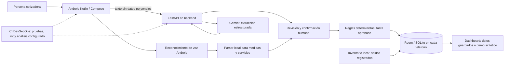

# Metodología de IA, arquitectura y seguridad

## Propósito y alcance

Este documento explica el prototipo Cotizador Leguía para la presentación académica. La aplicación implementa captura de requerimientos por voz/texto, una propuesta generativa opcional, revisión humana, cálculo determinista de tarifa y un panel de demostración de inventario. No afirma certificación ISO, seguridad absoluta, ni resultados empíricos de Leguía a partir de registros sintéticos.

## Enfoque metodológico de ingeniería

Se propone un ciclo iterativo e incremental con prácticas DevSecOps: planificar requisitos/riesgos, desarrollar en control de versiones, construir, probar, revisar seguridad, desplegar y monitorizar, y corregir hallazgos. Para calidad organizacional se documentan requisitos, responsables, cambios, defectos, evidencias y mejora continua tomando ISO 9001:2026 como referencia publicada vigente al preparar este documento. La aplicación de prácticas no demuestra conformidad ni certificación de la empresa.

Para el desarrollo seguro se usa como referencia el NIST SSDF (SP 800-218) y su guía DevSecOps; para evaluar calidad del producto se mantiene el modelo ISO/IEC 25010 en `qa/iso25010/`. ISO/IEC 27001 es la referencia de sistema de gestión de seguridad de la información a nivel organizacional. ISO 29001 está dirigida a proveedores de las industrias de petróleo, petroquímica y gas natural y complementa ISO 9001; no es una norma general de ciberseguridad para este cotizador. Si el docente indicó 29001 como requisito, conviene confirmar si se refería a ISO/IEC 27001.

| Referencia | Aplicación en este proyecto | Límite de la afirmación |
|---|---|---|
| ISO 9001:2026 | Gestión de requisitos, cambios, revisión, evidencias y mejora | Referencia de prácticas; no certificación ISO 9001 |
| NIST SSDF / DevSecOps | Integrar calidad y seguridad a lo largo del ciclo de desarrollo | La automatización disponible depende de ejecutar y revisar cada control |
| ISO/IEC 27001 | Marco para gestionar riesgos de seguridad de información | No hay SGSI organizacional ni certificación implantados por este proyecto |
| ISO/IEC 25010 | Características para evaluar calidad del producto de software | Evaluación parcial registrada en `qa/iso25010/` |
| ISO 29001 | Sector de petróleo, petroquímica y gas | No es la referencia adecuada para seguridad de esta app |

## Arquitectura actual y función de la IA

La IA generativa interpreta el texto y propone servicio, medidas y atributos expresamente mencionados; la persona corrige y confirma. No calcula precios ni decide si una cotización es óptima. La tarifa se obtiene de una regla aprobada que coincida con servicio, medida, material y variante configurada. Si no hay coincidencia, el flujo debe informar precio pendiente.

Room/SQLite guarda datos en el propio dispositivo. El backend FastAPI llama al proveedor de IA y actualmente no almacena cotizaciones ni sincroniza trabajadores. El dashboard del dispositivo resume los datos locales; el dashboard de demostración carga escenarios sintéticos. La demostración de faltantes aplica cantidades ficticias, no una receta de producción aprobada por la empresa.

## Evaluación técnica de IA

La capacidad implementada es extracción de campos mediante un modelo generativo preentrenado, no un modelo propio entrenado con el CSV de 200 cotizaciones. Para evaluarla técnicamente se debe construir un conjunto separado de frases de prueba y respuestas esperadas revisadas por una persona experta, sin identificadores personales. Reportar como mínimo:

- exactitud por campo (servicio, largo, ancho, material, tipo de carpa/moto, puertas/ventanas);
- tasa de campos omitidos correctamente cuando no aparecen en la frase;
- tasa de valores inventados y ambigüedades detectadas;
- proporción de propuestas aceptadas/corregidas por la persona;
- latencia y disponibilidad del backend, identificando proveedor/modelo y fecha.

El CSV sintético de 200 filas mide escenarios de cotización/stock simulados; no mide la precisión de Gemini y no es una muestra histórica real. No se deben mezclar esas métricas con resultados observacionales pretest/posttest.

## Métricas y gráficos del dashboard

El panel del jefe presenta tarjetas de cantidad solicitada, pendientes, concretadas, no concretadas, valor cotizado y conversión cerrada, además de barras horizontales de estados y conversión calculadas con las cotizaciones guardadas en ese teléfono. El dashboard de demostración de 200 filas presenta tarjetas de tiempo medio, precio medio/total, costos directos y aporte bruto estimado, y gráficos de barras de factibilidad y cantidad por servicio.

| Indicador | Definición en la app/demo | Interpretación |
|---|---|---|
| Conversión cerrada | Concretadas / (concretadas + no concretadas) × 100 | Excluye pendientes; datos locales en el panel real y simulados en demo |
| Tiempo medio | Promedio de minutos del dataset sintético | Ejercicio de análisis, no tiempo observado de Leguía |
| Factibilidad | Conteo de suficiente, faltante, incompleto o revisar aporte | Reglas/stock sintéticos de demo; no decisión automática operativa |
| Cotizaciones por servicio | Conteo por categoría | Distribución sintética en demo |
| Aporte directo | Precio simulado menos material directo simulado | Excluye mano de obra, indirectos, impuestos y otros costos |

Para el Capítulo IV, los gráficos deben salir del dataset observado y conservar la separación pretest/posttest. El demo de 200 filas solo sirve para verificar que el dashboard y la importación funcionan. SmartPLS/alfa de Cronbach no se deducen de estas barras ni del dataset de eventos; se requiere un instrumento de medición aprobado si se va a estudiar consistencia interna.

La propuesta indicador-por-indicador y la justificación de boxplots, run charts, intervalos de confianza, Pareto y heatmaps está en [METRICAS_APP_TESIS.md](METRICAS_APP_TESIS.md). No se agregan métricas DAU/retención por no estar en los objetivos/variables descritos.

## Seguridad y estado DevSecOps

- La clave de Gemini se configura en el backend por variable de entorno; no debe incluirse en APK, archivos versionados, capturas ni registros.
- La API local de demostración no autentica usuarios. El acceso al panel con credencial local del dispositivo no crea roles empresariales ni identidad compartida.
- La app no debe exponerse a trabajadores en producción hasta añadir autenticación/autorización del lado del servidor, HTTPS, límites de petición, protección de secretos, auditoría minimizada y política de retención.
- Los datos de cotizaciones son locales por dispositivo; el jefe no obtiene un tablero consolidado de todos los trabajadores.
- SonarQube requiere servidor y token configurados. Si no se ejecuta contra esa instancia, no se afirma que el Quality Gate pasó.
- Deben revisarse dependencias, manejo de secretos, permisos, validación de entrada, errores y migraciones, registrando hallazgos y acciones correctivas.

La revisión estática efectuada, correcciones locales y vulnerabilidades pendientes están detalladas en [REVISION_SEGURIDAD_LOCAL.md](REVISION_SEGURIDAD_LOCAL.md); no es un pentest ni un informe de cero vulnerabilidades.

## Referencias oficiales

- ISO 9001:2026: https://www.iso.org/standard/88464.html
- ISO/IEC 27001:2022: https://www.iso.org/standard/27001.html
- ISO 29001:2020: https://www.iso.org/standard/67773.html
- ISO/IEC 25010:2023: https://www.iso.org/standard/78176.html
- NIST SSDF SP 800-218: https://csrc.nist.gov/projects/ssdf
- NIST DevSecOps Practices: https://pages.nist.gov/nccoe-devsecops/
