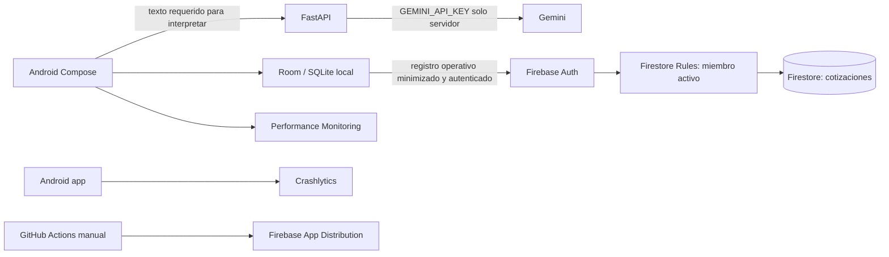

# Firebase: configuración y despliegue de prueba

## Estado de esta entrega

Esta rama incorpora integración opcional con Firebase; la aplicación continúa funcionando con Room/SQLite si Firebase no está configurado. La sesión local de Firebase CLI está autenticada con la cuenta del propietario. Se creó el proyecto dedicado `cotizador-leguia-poolns-2026` y se registró Android `com.leguia.cotizadoria` (Firebase App ID `1:643386841099:android:b2454fbcb34266d4910f0e`). El archivo `app/google-services.json` y el ID de organización en `local.properties` son configuración local ignorada por Git.

**Estado de base:** Cloud Firestore `(default)` existe en la región multirregional `nam5` (Estados Unidos), confirmado en Firebase Console el 25-11-2026. Las reglas e índices se publicaron correctamente. Email/Password está habilitado y se creó la cuenta de prueba `pieropoolc+cotizador-test@gmail.com`, con membresía activa en `organizations/cotizador-leguia-poolns-2026/members/{uid}`. No se guarda su contraseña en el repositorio. La ubicación de una base ya creada no se puede cambiar. No cambies el proyecto `.firebaserc`, ya apunta al proyecto dedicado.

**Distribución de ensayo:** se subió a Firebase App Distribution la versión `1.5.0 (8)` desde `app/build/outputs/apk/debug/app-debug.apk`; ID de release `48gqqn14hcu58`. El 25-11-2026 se agregó `pieropoolc+cotizador-test@gmail.com` como tester y se volvió a distribuir el release; Firebase confirmó que la distribución terminó correctamente. Es una compilación debug para ensayo, no un artefacto de producción. [Abrir release en Firebase Console](https://console.firebase.google.com/project/cotizador-leguia-poolns-2026/appdistribution/app/android:com.leguia.cotizadoria/releases/48gqqn14hcu58).

**Verificación local (25-11-2026):** `testDebugUnitTest`, `lintDebug` y `assembleDebug` terminaron correctamente después de migrar Room a KSP y actualizar AGP/Gradle por compatibilidad. La configuración Google Services se procesó. La APK debug se genera en `app/build/outputs/apk/debug/app-debug.apk`; no es un APK firmado para producción ni demuestra escritura remota en Firestore.

## Componentes y responsabilidades

| Componente | Uso | Límites conocidos |
|---|---|---|
| Room/SQLite | Copia local, cotización y operación sin conexión | Sigue siendo la fuente local; registros preexistentes permanecen locales. |
| Firebase Authentication | Acceso por correo/contraseña a cuentas habilitadas por el responsable | La app no ofrece creación pública de cuentas. Debe habilitarse Email/Password en Firebase Console. |
| Cloud Firestore | Registros minimizados de cotizaciones y tiempos observados | No recibe nombres, operador, texto libre del cliente, ni importes. Los documentos son inmutables desde cliente. |
| Performance Monitoring | Trazas agregadas `ai_interpretation`, `quote_local_save` y `cloud_quote_sync`, y métricas automáticas compatibles | No proporciona por sí solo un registro independiente por observación ni mide CPU/RAM por cotización. `quote_local_save` mide Room local; el tiempo de atención total se calcula con marcas inicio/comunicación y no se confunde con la traza. |
| Crashlytics | Fallos no fatales inesperados de sincronización, con mensaje saneado | No se adjuntan textos de solicitud, contraseñas, tokens ni datos del cliente. Debe revisarse privacidad/consentimiento antes de habilitarlo para usuarios reales. |
| App Distribution | Distribución interna del APK debug para dispositivos de ensayo | No es publicación Play Store ni artefacto release firmado para producción. |

Firebase no reemplaza al backend FastAPI/Gemini. Android conserva la URL de FastAPI configurable por compilación. La clave Gemini sigue exclusivamente en el servidor y no se incluye en APK, Firestore ni repositorio.

App Check / Play Integrity no está habilitado en este código. Firestore Authentication y Rules aplican el control de acceso descrito; antes de abrir el uso más allá del piloto, configurar App Check con huellas de firma de la app y validar el flujo de depuración en dispositivos de ensayo. No activar enforcement hasta comprobar las compilaciones debug y la release en el proyecto Firebase.

## Configuración manual del proyecto real

1. Proyecto creado: `cotizador-leguia-poolns-2026`. La app Android ya está registrada con el paquete `com.leguia.cotizadoria`. Conserva `app/google-services.json` solo en el equipo; está ignorado por Git.
2. Cloud Firestore `(default)` ya se creó en `nam5` (EE. UU.). La región no puede cambiarse; considera la ubicación al evaluar latencia para usuarios en Perú.
3. **Completado:** se publicaron `firestore.rules` y `firestore.indexes.json` con `firebase deploy --only firestore:rules,firestore:indexes --project cotizador-leguia-poolns-2026`. Las reglas compilaron y la publicación terminó exitosamente.
4. **Completado:** Authentication → Email/Password está habilitado y existe la cuenta de prueba dedicada `pieropoolc+cotizador-test@gmail.com`. No se habilitó registro abierto ni se incluyó la contraseña en Git.
5. **Completado:** se creó `organizations/cotizador-leguia-poolns-2026/members/tNqTIxHY83Xb2sRH5vUBdRPSUdU2` con `{ "active": true }` desde Firebase Console. No permitas que la app cliente cree o cambie membresías. Esta membresía concede acceso a leer cotizaciones minimizadas de esa organización y crear registros nuevos.
6. La organización local ya está configurada. La clave `firebaseOrganizationId` en `local.properties` contiene el ID de proyecto y el archivo no se publica. La URL del backend sigue siendo configurable allí:

   ```properties
   firebaseOrganizationId=cotizador-leguia-poolns-2026
   aiBackendUrl=https://URL_PUBLICA_DE_FASTAPI
   aiBackendUrlRelease=https://URL_PUBLICA_DE_FASTAPI
   ```

   `aiBackendUrlRelease` debe usar HTTPS. El identificador de organización no es una clave; aun así, no debe permitir acceso sin las reglas.
7. **Pruebas de reglas completadas:** 5 pruebas del emulador Firestore pasan: denegar escritura no autenticada, denegar miembro inactivo/inexistente, permitir creación/lectura de registro minimizado para miembro activo, rechazar campos libres/actualización y bloquear lectura entre organizaciones. Estas pruebas usan el emulador y no son escrituras en la base productiva. Nunca uses credenciales de usuario dentro del cliente Android.
8. **Completado:** se agregó la cuenta de prueba como tester de App Distribution y se asignó al release `48gqqn14hcu58`. En el teléfono, inicia sesión con esa cuenta, realiza una cotización nueva y confirma que aparece en `organizations/{ORGANIZATION_ID}/quotes`; comprueba también que una cuenta no miembro recibe denegación. No uses información identificable real durante la prueba.

## Distribución de pruebas desde GitHub Actions

El flujo manual `.github/workflows/firebase-distribution.yml` compila, ejecuta pruebas Android, publica reglas y distribuye el APK debug a una lista explícita. El release de ensayo se cargó manualmente; el flujo de GitHub todavía no se configuró con sus secretos. Requiere configurar en Settings → Secrets and variables → Actions:

| Secreto | Valor |
|---|---|
| `FIREBASE_PROJECT_ID` | ID del proyecto Firebase real |
| `FIREBASE_ANDROID_APP_ID` | ID de la app Android registrado en Firebase |
| `FIREBASE_ORGANIZATION_ID` | Mismo ID usado por el cliente |
| `FIREBASE_SERVICE_ACCOUNT_JSON` | JSON de cuenta de servicio con permisos mínimos para distribuir app y desplegar reglas |
| `FIREBASE_TESTERS` | Correos de testers autorizados, separados por coma |
| `GOOGLE_SERVICES_JSON_BASE64` | Contenido Base64 de `google-services.json` |
| `AI_BACKEND_URL` | URL HTTPS del backend para el APK debug de prueba |

No pongas estos valores en archivos versionados ni en mensajes. La cuenta de servicio debe ser específica del proyecto, con permisos mínimos; revócala si se expone. El flujo está limitado a `workflow_dispatch` para impedir despliegues involuntarios. La prueba distribuida es `debug` y no debe publicarse en una tienda.

## Flujo y privacidad de datos



El registro cloud incluye ID aleatorio, UID propietario, códigos de servicio/material, medidas, estado, modo de asistencia (manual o con IA), marcas de tiempo, duración, confirmación de comunicación, versión, modelo de dispositivo, nivel Android, tipo de red y fecha del servidor. No incluye `requerimientoCliente`, operador, transcripción de IA, precio, correo de inicio de sesión ni tokens. El texto enviado a FastAPI/Gemini puede contener datos personales escritos por la persona que atiende; la app no los copia a Firebase, pero el servidor/proveedor sí procesa el texto necesario para interpretar. Indica al usuario que no escriba datos personales innecesarios.

La hora de inicio se genera al abrir el flujo en Android y la hora de comunicación cuando el operador marca su confirmación. Son marcas declaradas por el dispositivo/usuario, no evidencia independiente resistente a manipulación. `uploadedAt` lo genera Firestore y solo acredita el momento de sincronización.

El destino Firestore conserva identificadores UID de Authentication, medidas y estados operativos; son datos seudonimizados, no anónimos. Define con el asesor responsable quién accede, la retención y la autorización de participantes antes de cargar datos de campo. El SDK puede recopilar datos técnicos del dispositivo en Crashlytics/Performance según la configuración del producto; revisa los avisos y controles de privacidad correspondientes.

## Persistencia y reintentos

- La base Room pasa de versión 9 a 10, con migración que asigna ID aleatorio, UID opcional y estado `LOCAL_ONLY` a filas antiguas.
- Solo las cotizaciones creadas con una sesión Firebase iniciada quedan en `PENDING` y se sincronizan.
- El sincronizador usa WorkManager y requiere conexión. Los fallos reintentables se vuelven a intentar; no borra la copia Room.
- Cerrar sesión afecta a nuevas cotizaciones; los registros ya asignados a otra cuenta no se transfieren ni cambian de propietario.
- Las reglas prohíben actualizar/eliminar registros desde cliente y niegan por defecto cualquier ruta no declarada.

## Rotación de credenciales

Si una clave, token, archivo de servicio o URL privada se publica accidentalmente: revócala en el proveedor, genera una nueva desde el panel seguro, actualiza únicamente Firebase/GitHub Secrets o el servidor y revisa el historial del repositorio. Borrar el archivo en un commit posterior no invalida una credencial ya expuesta.

## Enlaces oficiales

- [Configurar Firebase en Android](https://firebase.google.com/docs/android/setup)
- [Reglas de seguridad de Firestore](https://firebase.google.com/docs/firestore/security/overview)
- [Emulador y pruebas de reglas](https://firebase.google.com/docs/rules/unit-tests)
- [Performance Monitoring para Android](https://firebase.google.com/docs/perf-mon/get-started-android)
- [Crashlytics para Android](https://firebase.google.com/docs/crashlytics/android/get-started)
- [Firebase App Distribution](https://firebase.google.com/docs/app-distribution)
- [Habilitar servicios de Google Cloud](https://cloud.google.com/service-usage/docs/enable-disable)

## Estado actual y continuación

La base `(default)` existe en `nam5` (EE. UU.); reglas e índices están publicados y las cinco pruebas de reglas pasaron en el emulador. Email/Password, cuenta de prueba, membresía activa y asignación como tester quedaron configuradas. Firebase confirmó que el release `48gqqn14hcu58` se distribuyó al tester. **Sigue pendiente** iniciar sesión en el dispositivo con la cuenta nueva y comprobar una escritura y lectura real de cotización en Firestore; hasta entonces no se afirma sincronización Android verificada. También falta configurar los secretos para automatizar distribución desde GitHub. `npm audit` reportó cinco vulnerabilidades altas transitivas en el SDK de Firebase usado únicamente por las pruebas de reglas; no se forzó una actualización incompatible. El Node local 22.18 muestra avisos de motor (el workflow fija Node 24.12) aunque las pruebas del emulador terminaron pasando.
