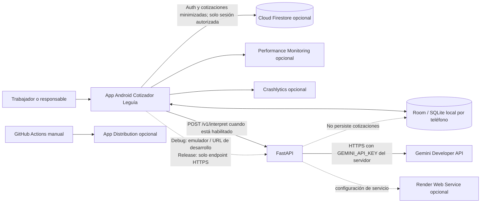
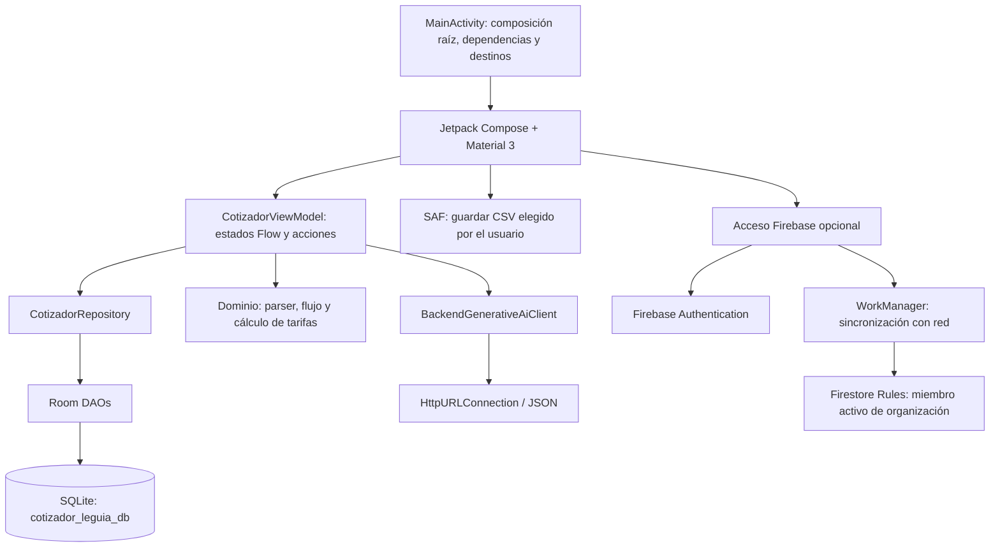
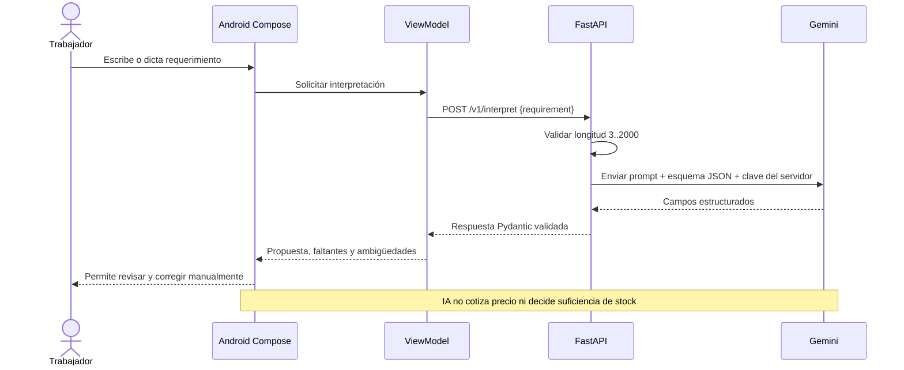
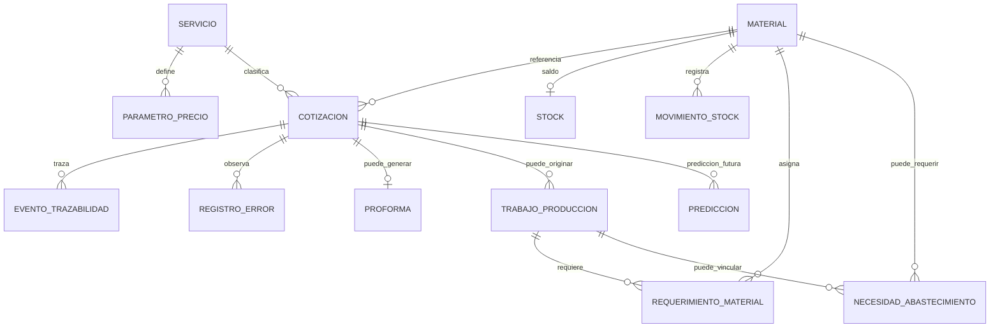

# Diagramas de arquitectura

Los diagramas describen componentes del código. En `codex/firebase-integration` la integración Firebase es opcional: solo se activa con `app/google-services.json` y `firebaseOrganizationId` local. No existe un proyecto Firebase real configurado ni se afirma que la nube esté desplegada. Ver [configuración y despliegue Firebase](../firebase/CONFIGURACION_Y_DESPLIEGUE.md).

## Contexto del sistema

## Capas Android observadas

La inyección de dependencias y navegación son manuales desde `MainActivity`; no se encontró una librería DI ni un `NavController`. `rememberSaveableStateHolder` conserva estado Compose de destinos durante la navegación. Persistencia comercial y reglas de precios se resuelven en Room y dominio local.

En la rama Firebase, Room sigue siendo el almacén local. Los registros nuevos con una cuenta activa se sincronizan de forma diferida; registros ya existentes no se suben automáticamente. La nube recibe un subconjunto operativo, no el texto libre ni el precio. La versión Room pasa a 10 mediante migración 9→10.

## Flujo de interpretación IA

Si el dispositivo está en modo sin conexión, la llamada IA no está habilitada y la persona completa los campos manualmente. Fallos del servicio deben permitir reintento o captura manual.

## Modelo de datos Room simplificado

`Prediccion`, `Proforma`, producción y abastecimiento están en el esquema, pero no todos tienen una pantalla o flujo operativo completo. La presencia de una entidad no demuestra que la funcionalidad esté implementada de extremo a extremo.
